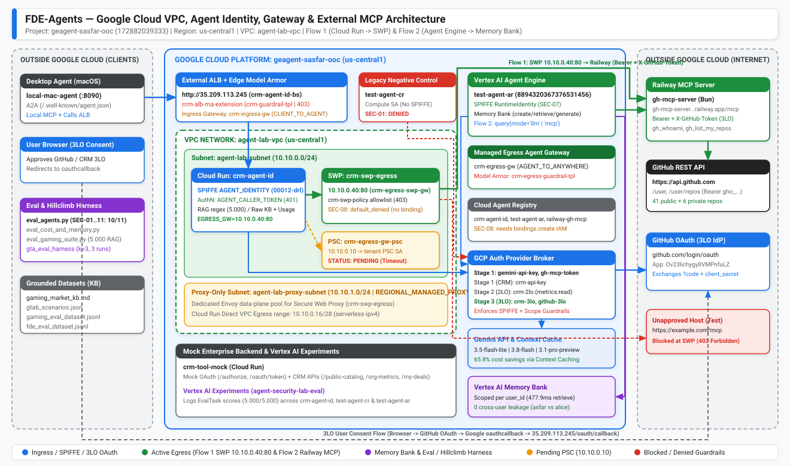

# FDE-Agents: End-to-End GCP Agent Identity, Gateway, MCP & Eval Test Bed

> **Google Cloud Project:** `geagent-sasfar-ooc` (`172882039333`) &bull; **Region:** `us-central1`  
> **Interactive Simulator v2 (SWP, PSC, Agent Engine, Memory Bank):** [`docs/test_bed_simulator_v2.html`](docs/test_bed_simulator_v2.html)  
> **Interactive VPC Topology Animation:** [`docs/gcp_vpc_topology_animation.html`](docs/gcp_vpc_topology_animation.html)  
> **Full Architecture Reference:** [`docs/test_bed_architecture.md`](docs/test_bed_architecture.md) &bull; **GTA 6 Harness Guide:** [`gta_eval_harness/README.md`](gta_eval_harness/README.md)

---

## 1. Google Cloud VPC & End-to-End Architecture



---

## 2. End-to-End Flows

1. **Ingress & Prompt Guardrails (`local-mac-agent` / Client → ALB → `crm-agent-id`):**
   - External callers hit the External ALB (`http://35.209.113.245` / `crm-agent-id-bs`), where Edge Model Armor (`crm-alb-ma-extension`, template `crm-guardrail-tpl`, `failOpen: false`) inspects inbound prompts (`SEC-05`).
   - `crm-agent-id` (`rev 00012-drl`, `internal-and-cloud-load-balancing`) enforces `enforce_caller_authn` middleware requiring `Authorization: Bearer <AGENT_CALLER_TOKEN>`, `X-Agent-Auth: <AGENT_CALLER_TOKEN>`, or `X-Goog-IAP-JWT-Assertion` (`SEC-11` verified `401` on unauthenticated calls; `/health`, `/oauth/callback`, `/favicon.ico`, `/.well-known/agent.json` exempt).
2. **SPIFFE Identity & Auth Provider Broker (`agentidentitycredentials.googleapis.com`):**
   - Both `crm-agent-id` (`AGENT_IDENTITY`) and `test-agent-ar` (`RuntimeIdentity`) authenticate with cryptographic SPIFFE identities (`principal://agents.global.org-91854922466.system.id.goog/...`). Legacy Compute SA (`test-agent-cr`) is rejected (`SEC-01`).
   - The Broker vaults and scopes downstream credentials (`gemini-api-key`, `gh-mcp-token`, `crm-api-key`, `crm-2lo`, `crm-3lo`, `github-3lo`) with zero secrets in agent source code.
3. **Flow 1 — Cloud Run VPC Egress via Secure Web Proxy (`crm-agent-id` → `10.10.0.40:80`):**
   - `crm-agent-id` routes outbound calls through Direct VPC Egress (`agent-lab-subnet` `10.10.0.0/24`) to SWP `crm-swp-egress` (`10.10.0.40:80`), backed by `selfManaged` AgentGateway `crm-egress-swp-gw`.
   - `crm-swp-policy` allows approved CRM & Railway MCP hosts and blocks unapproved hosts (`example.com` → `403`). `SEC-08` enforces `default_denied` at SWP until an Agent Registry Binding connects `crm-agent-id` → `railway-gh-mcp`.
4. **Flow 2 — Vertex AI Agent Engine + Memory Bank + 3LO GitHub MCP (`test-agent-ar`):**
   - `test-agent-ar` (`ReasoningEngine 8894320367376531456`) creates a fresh `AuthProviderCredentialsServiceClient()` per `call_mcp` call, fetches `gh-mcp-token` and user-scoped `github-3lo` tokens, and invokes live Railway MCP tools (`gh_whoami`, `gh_list_my_repos`) under `crm-egress-gw` (`AGENT_TO_ANYWHERE`, Model Armor `crm-egress-guardrail-tpl`).
   - Vertex AI Memory Bank stores and retrieves user-scoped facts (`asfar` vs. `alice`) with `0` cross-user leakage.

---

## 3. Core Components

| Component | Location / Platform | Role |
|---|---|---|
| [`agent_cr_id/`](agent_cr_id/) | Cloud Run (`agent-lab-vpc`, `internal-and-cloud-load-balancing`) | **`crm-agent-id`** (`rev 00012-drl`) — SPIFFE `AGENT_IDENTITY` agent behind ALB `35.209.113.245`; `enforce_caller_authn` (`401`), `model` override, regex-tokenized `rag` / `raw_kb` grounding, usage telemetry, and SWP egress (`10.10.0.40:80`). |
| [`agent_ar/`](agent_ar/) | Vertex AI Agent Engine (`us-central1`) | **`test-agent-ar`** (`ReasoningEngine 8894320367376531456`) — SPIFFE `RuntimeIdentity`, Memory Bank integration, `mode="llm" \| "mcp"` (live Railway 3LO GitHub MCP). |
| [`agent_cr/`](agent_cr/) | Cloud Run (`us-central1`) | **`test-agent-cr`** — Legacy Compute SA negative control (`SEC-01` denied by Auth Broker). |
| [`gh_mcp_server/`](gh_mcp_server/) | Railway (Bun Function) | **`gh-mcp-server`** (`https://gh-mcp-server-production.up.railway.app/mcp`) — Streamable HTTP MCP server validating `Bearer` + `X-GitHub-Token` and executing live GitHub API calls (`gh_whoami`, `gh_list_my_repos`, `gh_get_poisoned_issue`). |
| [`local_agent/`](local_agent/) | macOS (`localhost:8090`) | **`local-mac-agent`** — Local desktop A2A + MCP agent calling GCP ALB `35.209.113.245`. |
| [`agent_gateway/`](agent_gateway/) | GCP Network Services / Security | Model Armor (`crm-alb-ma-extension`, `crm-egress-ma-extension`), `crm-ingress-gw`, `crm-egress-gw`, and `crm-egress-swp-gw` (`selfManaged` over `crm-swp-egress`). |
| [`crm_mock/`](crm_mock/) | Cloud Run (`us-central1`) | Mock enterprise CRM + OAuth server for Stage 1 (`crm-api-key`), Stage 2 (`crm-2lo`), and Stage 3 (`crm-3lo` + PKCE). |

---

## 4. Security & Identity Verification (`eval_agents.py`)

- **Layer 1 (Vertex AI `EvalTask` → `agent-security-lab-eval`):** **`5.000 / 5.000`** across `crm-agent-id`, `test-agent-cr`, and `test-agent-ar`.
- **Layer 2 (`SEC-01..SEC-11`):** **`10 / 11` PASSED**:
  - **Passing (`10`):** `SEC-01` (Legacy SA denied), `SEC-02` (2LO scope block), `SEC-03` (3LO scope block), `SEC-04` (`charlie@sadasystems.com` `CONSENT_REQUIRED`), `SEC-05` (Edge Model Armor prompt block), `SEC-06` (Egress Model Armor), `SEC-07` (`RuntimeIdentity` in Agent Registry), `SEC-09` (SWP `example.com` `403`), `SEC-10` (GitHub 3LO `ALLOWED` + `delete_repo` `DENIED_BY_GCP_BROKER`), `SEC-11` (unauthenticated ALB call returns `401`).
  - **Blocked (`1` — `SEC-08`):** `railway-gh-mcp` is registered in Agent Registry (`urn:mcp:projects-172882039333:projects:172882039333:locations:us-central1:agentregistry:services:railway-gh-mcp`), and `crm-egress-swp-gw` enforces `default_denied` (`403`) at SWP until `agentregistry.bindings.create` IAM permission on `projects/geagent-sasfar-ooc/locations/us-central1` is granted to create the binding `crm-agent-id` → `railway-gh-mcp`.

---

## 5. Evaluation, RAG & GTA 6 Hillclimbing Suites

### Gaming RAG vs. Raw KB vs. Memory Bank (`eval_gaming_suite.py`)
Regex tokenization (`re.findall(r"[a-z0-9]+", ...)`) in `_retrieve_kb_context` raised `rag` to **`5.000` Groundedness** across all three Gemini models with **`45.0%` fewer prompt tokens** than `raw_kb` (`768.1` vs `1397.1`):

| Run | Mode / Model | Fact Recall | Ref Correctness | Groundedness | Avg Prompt Tokens | Avg Latency | Est / 1k (USD) |
|---|---|---|---|---|---|---|---|
| `1_baseline_ungrounded` | `none` / `gemini-3.8-flash` | `0.345238` | `3.000` | `2.929` | `143.1` | `9014.7 ms` | `$2.1808` |
| `2a_rag_flash_lite` | `rag` / `gemini-3.5-flash-lite` | `0.952381` | `5.000` | `5.000` | `768.1` | `808.5 ms` | `$0.122243` |
| `2b_rag_3.8_flash` | `rag` / `gemini-3.8-flash` | `1.000000` | `5.000` | `5.000` | `768.1` | `5023.2 ms` | `$1.414729` |
| `2c_rag_3.1_pro` | `rag` / `gemini-3.1-pro-preview` | `1.000000` | `4.929` | `5.000` | `768.1` | `5473.7 ms` | `$8.367329` |
| `3_raw_kb_3.8_flash` | `raw_kb` / `gemini-3.8-flash` | `1.000000` | `5.000` | `5.000` | `1397.1` | `4336.0 ms` | `$1.411286` |
| `4_ar_memory_bank` | `memory_bank` / `gemini-3.8-flash` | `1.000000` | `5.000` | `5.000` | `1551.0` | `6210.4 ms` | `$1.865300` |

### GTA 6 Sales Prediction Autorater (`gta_eval_harness/`)
8-rubric autorater (`k=3` passes, Krippendorff's Alpha) predicting GTA 6 sales across console platform split, Online vs. Offline LTV, marketing ROI, and downside risk (see [`gta_eval_harness/README.md`](gta_eval_harness/README.md)):

| Run | Model / Grounding | Overall Mean | Avg Latency | Est. Cost / 1k Reports |
|---|---|---|---|---|
| `gta_hillclimb_1` | `gemini-3.8-flash` / `none` | `2.68 / 5.00` | — | — |
| `gta_hillclimb_2` | `gemini-3.8-flash` / `raw_kb` | `3.83 / 5.00` | `16013.4 ms` | `$5.6225` |
| `gta_hillclimb_3` | `gemini-3.5-flash-lite` / `raw_kb` | `3.04 / 5.00` | `2083.1 ms` | `$0.3502` |

### Cost, Context Caching & Memory (`eval_cost_and_memory.py` & `eval_memory_bank.py`)
- **Context Caching:** Saved **65.8%** on KB input token cost.
- **Vertex AI Memory Bank:** Retrieved scoped user facts in **477.9 ms** with **0** cross-user leakage (`asfar` vs. `alice`).

---

## 6. Running the Suites

```bash
# Security, Identity, Model Armor & Agent Registry checks (SEC-01..SEC-11)
.venv/bin/python eval_agents.py

# Unified Before/After Grounding x Model x Cost suite
.venv/bin/python eval_gaming_suite.py

# GTA 6 Sales Prediction Autorater & Hillclimbing (k=3 passes)
.venv/bin/python gta_eval_harness/run_gta_hillclimb.py --grounding-mode raw_kb --model gemini-3.8-flash --k-passes 3

# Cost Lens, Gemini Context Caching & SQLite Memory
.venv/bin/python eval_cost_and_memory.py

# Vertex AI Agent Engine Memory Bank isolation
.venv/bin/python eval_memory_bank.py
```
