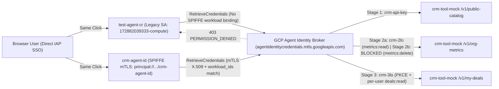

# Live Side-by-Side Agent Identity Security Lab: API Key → 2-Legged OAuth → 3-Legged OAuth

Everything is now **deployed and live** in **`geagent-sasfar-ooc`** (`us-central1`). Both Cloud Run agents execute the **exact same Python application code** ([app.py](file:///Users/asfar.shah/Downloads/SADA/Projects/FDE-Agents/agent_cr_id/app.py) / [app.py](file:///Users/asfar.shah/Downloads/SADA/Projects/FDE-Agents/agent_cr/app.py)) with **zero secrets in environment variables or source code**—so every difference you observe comes strictly from **GCP Agent Identity** (`principal://...` SPIFFE mTLS + `AuthProvider` workload bindings).

---

## 1. Live Deployed Services (Open These 3 Tabs Side by Side)

| Tab | Service | Live URL | Runtime Identity & Registry Posture | Expected Lab Outcome |
| :--- | :--- | :--- | :--- | :--- |
| **Tab 1 (Left)** | **Older Agent** (`test-agent-cr`) | https://test-agent-cr-172882039333.us-central1.run.app | Legacy Compute SA (`172882039333-compute@developer.gserviceaccount.com`) — **Not in Agent Registry**, **No SPIFFE Cert** | ❌ **Denied (`DENIED_BY_GCP_BROKER`)** on Stages 1, 2a, 2b, and 3 |
| **Tab 2 (Middle)** | **New Agent** (`crm-agent-id`) | https://crm-agent-id-172882039333.us-central1.run.app | Keyless SPIFFE X.509 (`principal://agents.global.org-91854922466.system.id.goog/resources/run/projects/172882039333/locations/us-central1/services/crm-agent-id`) — **Auto-registered in Agent Registry** | ✅ **Allowed** on Stage 1, Stage 2a, and consented Stage 3; ❌ **Blocked** on Stage 2b (`metrics:delete`) |
| **Tab 3 (Right)** | **Mock Enterprise CRM** (`crm-tool-mock`) | https://crm-tool-mock-172882039333.us-central1.run.app | Self-contained CRM API + OAuth 2.0 / PKCE Authorization & Token Server ([app.py](file:///Users/asfar.shah/Downloads/SADA/Projects/FDE-Agents/crm_mock/app.py)) | 📊 Live **Security Audit Log** showing every API Key, 2LO, and 3LO token check |

> [!IMPORTANT]
> **Use the exact `crm-agent-id` URL above (`https://crm-agent-id-172882039333.us-central1.run.app`)** when testing Stage 3 (3-Legged OAuth), because GCP validates that the callback host matches `--three-legged-oauth-default-continue-uri` (`https://crm-agent-id-172882039333.us-central1.run.app/oauth/callback`).

---

## 2. Live Architecture & Security Enforcement Flow



### Provisioned GCP `AuthProvider` Resources (`us-central1`)
All three providers are live and bound **exclusively** to `crm-agent-id` (reproducible in [setup_auth_providers.sh](file:///Users/asfar.shah/Downloads/SADA/Projects/FDE-Agents/setup_auth_providers.sh)):
- **`crm-api-key`** (`API_KEY`): Vaults `sk-crm-live-demo-98765`.
- **`crm-2lo`** (`TWO_LEGGED_OAUTH`): Token URL `.../oauth/token`, `--allowed-scopes=metrics:read`, `--blocked-scopes=metrics:delete`.
- **`crm-3lo`** (`THREE_LEGGED_OAUTH` + PKCE `S256`): Auth URL `.../oauth/authorize`, Token URL `.../oauth/token`, `--allowed-scopes=deals:read`, `--blocked-scopes=deals:admin`, deterministic GCP broker `redirectUrl`:
  `https://agentidentitycredentials.googleapis.com/v1/projects/geagent-sasfar-ooc/locations/us-central1/authProviders/crm-3lo/oauthcallback`

---

## 3. Step-by-Step Side-by-Side Testing Walkthrough

### Step 0: Compare Runtime Banners & GCP Native IAM (`Stage 0`)
1. Look at the top banner of **Tab 1 (`test-agent-cr`)** vs. **Tab 2 (`crm-agent-id`)**:
   - **Tab 1 (`test-agent-cr`)** shows red/amber **Legacy Service Account** (`172882039333-compute@developer.gserviceaccount.com`) and non-mTLS endpoint `agentidentitycredentials.googleapis.com`.
   - **Tab 2 (`crm-agent-id`)** shows green **SPIFFE Agent Identity Enabled** (`principal://agents.global.org-91854922466.system.id.goog/resources/run/projects/172882039333/locations/us-central1/services/crm-agent-id`) and mTLS endpoint `agentidentitycredentials.mtls.googleapis.com` (automatically activated via mounted `/var/run/secrets/workload-spiffe-credentials/certificates.pem`).
2. Click **Test Vertex AI Gemini Call** at the bottom of **Tab 2 (`crm-agent-id`)** → succeeds via the `roles/aiplatform.user` binding granted directly to its `principal://...` identity.

---

### Step 1: Test Vaulted API Key + Live Kill-Switch (`Stage 1`)
1. Click **🔑 Stage 1: Fetch Public Catalog (API Key)** in **Tab 1 (`test-agent-cr`)**:
   - **Result:** `DENIED_BY_GCP_BROKER` (`403`). Even though `test-agent-cr` runs in the same GCP project, it cannot retrieve the vaulted key—and **Tab 3 (`crm-tool-mock`)** receives zero traffic from it.
2. Click **🔑 Stage 1: Fetch Public Catalog (API Key)** in **Tab 2 (`crm-agent-id`)**:
   - **Result:** `ALLOWED` (`200`)! GCP validates `crm-agent-id`'s SPIFFE certificate, injects the vaulted key, and returns the SKU catalog. Refresh **Tab 3 (`crm-tool-mock`)** to see the `200` `API_KEY` audit entry.
3. **Test the Live Emergency Kill-Switch** (run in your terminal or Cloud Shell—no container redeploy needed):
   ```bash
   gcloud agent-identity auth-providers disable crm-api-key \
     --location=us-central1 --project=geagent-sasfar-ooc
   ```
   Click **Stage 1** in **Tab 2 (`crm-agent-id`)** again → **instantly blocked**! Re-enable when ready:
   ```bash
   gcloud agent-identity auth-providers enable crm-api-key \
     --location=us-central1 --project=geagent-sasfar-ooc
   ```

---

### Step 2: Test 2-Legged OAuth + Scope Escalation Guardrail (`Stage 2a` vs `Stage 2b`)
1. **Tab 1 (`test-agent-cr`)** → Click **⚙️ Stage 2a** → `DENIED_BY_GCP_BROKER`.
2. **Tab 2 (`crm-agent-id`)** → Click **⚙️ Stage 2a: Fetch Org Metrics (`metrics:read`)**:
   - **Result:** `ALLOWED` (`200`). GCP exchanges `crm-m2m-client` credentials behind the scenes at `/oauth/token` and hands `crm-agent-id` only a short-lived `Bearer` token (`metrics:read`). Refresh **Tab 3** to see both `2LO_TOKEN_ISSUED` and `2LO_BEARER` events!
3. **Tab 2 (`crm-agent-id`)** → Click **🛑 Stage 2b: Try Blocked Scope (`metrics:delete`)** *(simulating a prompt-injected agent trying to purge CRM metrics)*:
   - **Result:** `DENIED_BY_GCP_BROKER`! Refresh **Tab 3 (`crm-tool-mock`)**—notice **no token request ever reached the CRM OAuth server** because GCP's control plane blocked `metrics:delete` before minting a token.

---

### Step 3: Test 3-Legged OAuth (PKCE, Per-User Isolation & Consent Revocation) (`Stage 3`)
1. **Tab 1 (`test-agent-cr`)** → Click **👤 Stage 3** → `DENIED_BY_GCP_BROKER` (cannot even initiate a consent prompt).
2. **Tab 2 (`crm-agent-id`)** *(with `asfar.shah@insight.com` selected in the dropdown)* → Click **👤 Stage 3: Fetch My Private Deals (`deals:read`)**:
   - **Result:** `CONSENT_REQUIRED`! Because you haven't delegated access yet, a green **Open Acme CRM Consent Screen ↗** button appears.
3. Click **Open Acme CRM Consent Screen ↗**:
   - Notice on the consent screen that GCP automatically generated a **PKCE `S256` `code_challenge`** and set the redirect URI to Google's broker (`.../authProviders/crm-3lo/oauthcallback`).
   - Keep `asfar.shah@insight.com` selected and click **Approve Delegated Access**.
   - Google's broker exchanges the authorization code + PKCE `code_verifier` at `crm-tool-mock/oauth/token`, vaults your refresh/access token, and redirects back to `/oauth/callback` (`FinalizeCredentials`), which automatically triggers Stage 3 in Tab 2!
   - **Result:** `ALLOWED` (`200`) returning **only Asfar's 3 enterprise deals** (`DL-9001`, `DL-9002`, `DL-9003`).
4. **Test Per-User Confused-Deputy Isolation:**
   - In **Tab 2 (`crm-agent-id`)**, switch the **Simulated End-User Identity** dropdown from `asfar.shah@insight.com` to **`alice@sadasystems.com`** and click **👤 Stage 3**.
   - **Result:** `CONSENT_REQUIRED`! Even though the agent already holds Asfar's token, GCP refuses to reuse Asfar's token for Alice (`user_id="alice@sadasystems.com"`). If you approve consent as `alice@sadasystems.com`, Stage 3 returns **only Alice's 2 retail deals** (`DL-4101`, `DL-4102`).
5. **Inspect & Revoke Active User Consent Live:**
   ```bash
   # List active per-user 3LO consents:
   gcloud agent-identity auth-providers authorizations list crm-3lo \
     --location=us-central1 --project=geagent-sasfar-ooc

   # Revoke Asfar's consent immediately:
   gcloud agent-identity auth-providers revoke-authorization crm-3lo \
     --location=us-central1 \
     --project=geagent-sasfar-ooc \
     --user-id="asfar.shah@insight.com"
   ```
   Click **Stage 3** as `asfar.shah@insight.com` again → immediately reverts to `CONSENT_REQUIRED`!

---

## 4. GCP Console Validation Checklist (Where to Watch Everything Change)

1. **Agent Registry (`us-central1`) — Registered vs. Unregistered Side by Side:**
   - Open: https://console.cloud.google.com/agent-registry?project=geagent-sasfar-ooc
   - **What you see:** `crm-agent-id` (and `test-agent-ar`, `weather-agent`) appear in Agent Registry; `crm-agent-id` displays its Cloud Run Agent Runtime linkage and SPIFFE identity, whereas `test-agent-cr` does **not** appear at all.
2. **IAM & Admin → IAM — Keyless `principal://` Bindings:**
   - Open: https://console.cloud.google.com/iam-admin/iam?project=geagent-sasfar-ooc
   - Filter by `crm-agent-id` (and check *"Include Google-provided role grants"* if needed): you will see `principal://agents.global.org-91854922466.system.id.goog/resources/run/projects/172882039333/locations/us-central1/services/crm-agent-id` holding **Vertex AI User** (`roles/aiplatform.user`) and **Agent Identity User** (`roles/agentidentity.user`), plus your own account now holding **Agent Identity Admin** (`roles/agentidentity.admin`).
3. **Cloud Run → `crm-agent-id` vs `test-agent-cr` → Security / Revisions Tab:**
   - Open: https://console.cloud.google.com/run?project=geagent-sasfar-ooc
   - Compare `crm-agent-id` (`Agent Identity` enabled, `Service Account: None`) vs. `test-agent-cr` (`172882039333-compute@developer.gserviceaccount.com`).
4. **Logs Explorer — Real-Time Broker Allow/Deny Audit Trail:**
   - Open: https://console.cloud.google.com/logs/query?project=geagent-sasfar-ooc
   - Run this query after clicking Stages 1–3 on both agents:
     ```text
     protoPayload.serviceName=("agentidentity.googleapis.com" OR "agentidentitycredentials.googleapis.com")
     ```
   - Expand any `RetrieveCredentials` log entry to compare `authenticationInfo.principalEmail` / `principalSubject` for `test-agent-cr` (denied) vs. `crm-agent-id` (allowed on `metrics:read`, denied on `metrics:delete`).
5. **CLI Governance Rollup (`access-summaries` & Posture Verifier):**
   ```bash
   # Run the automated posture comparison script locally:
   .venv/bin/python test_side_by_side_lab.py

   # View hourly governance rollups (workloadId, authProviderType, userId, scopes):
   gcloud agent-identity access-summaries list \
     --location=us-central1 --project=geagent-sasfar-ooc
   ```

---

## 5. Source Files Created / Updated in Workspace
- **Mock Enterprise CRM & OAuth 2.0 / PKCE Server:** [app.py](file:///Users/asfar.shah/Downloads/SADA/Projects/FDE-Agents/crm_mock/app.py), [deploy_crm_mock.sh](file:///Users/asfar.shah/Downloads/SADA/Projects/FDE-Agents/crm_mock/deploy_crm_mock.sh)
- **New Agent (`crm-agent-id` with SPIFFE Agent Identity):** [app.py](file:///Users/asfar.shah/Downloads/SADA/Projects/FDE-Agents/agent_cr_id/app.py), [deploy_cr_id.sh](file:///Users/asfar.shah/Downloads/SADA/Projects/FDE-Agents/agent_cr_id/deploy_cr_id.sh)
- **Older Agent (`test-agent-cr` running identical code on legacy SA):** [app.py](file:///Users/asfar.shah/Downloads/SADA/Projects/FDE-Agents/agent_cr/app.py)
- **Auth Providers & Posture Verification:** [setup_auth_providers.sh](file:///Users/asfar.shah/Downloads/SADA/Projects/FDE-Agents/setup_auth_providers.sh), [test_side_by_side_lab.py](file:///Users/asfar.shah/Downloads/SADA/Projects/FDE-Agents/test_side_by_side_lab.py)
