# FDE-Agents Complete End-to-End Test Bed Architecture

> **Project:** `geagent-sasfar-ooc` (`172882039333`) &bull; **Region:** `us-central1`  
> **Scope:** All agents inside & outside Google Cloud, all configured auth methods (SPIFFE, API Key, 2LO, 3LO + PKCE, GitHub 3LO), Ingress/Egress Gateways, SWP, Model Armor, Agent Registry, and Evaluation Suites.

---

## 1. End-to-End Architecture Diagram (Inside & Outside GCP)

```mermaid
flowchart TB
    subgraph EXT["Zone A: Outside Google Cloud"]
        MAC["Desktop Agent: local-mac-agent\nmacOS localhost:8090\nA2A (/.well-known/agent.json) + local MCP (/mcp)"]
        BROWSER["User Browser\n3LO OAuth Consent"]
        RAILWAY["Railway MCP Server (Bun Function)\ngh-mcp-server-production.up.railway.app/mcp\nTools: gh_whoami, gh_list_my_repos, gh_list_issues,\ngh_get_pr, gh_create_issue, gh_get_poisoned_issue"]
        RENDER_REF["Render MCP Template (Workspace)\ngithub-mcp-render/ (Python MCPServer)"]
        GITHUB_OAUTH["GitHub OAuth App\nClient ID: Ov23lichygy8VMPnfuLZ"]
        GITHUB_API["GitHub REST API\nhttps://api.github.com"]
    end

    subgraph EDGE["Zone B: GCP Edge & Ingress Security (us-central1)"]
        ALB["External ALB (crm-agent-id-fr -> crm-agent-id-bs)\nhttp://35.209.113.245 (HTTP)"]
        ALB_MA["Model Armor AuthzExtension\ncrm-alb-ma-extension\ntemplate: crm-guardrail-tpl | failOpen: false"]
        INGRESS_GW["Agent Gateway Ingress\ncrm-ingress-gw (CLIENT_TO_AGENT)\ncrm-ma-extension + crm-ma-authz-policy"]
    end

    subgraph VPC["Zone C: agent-lab-vpc (us-central1)"]
        SUBNET["agent-lab-subnet (10.10.0.0/24)\nCloud Run Direct VPC Egress"]
        PROXY_SUB["agent-lab-proxy-subnet (10.10.1.0/24)\nREGIONAL_MANAGED_PROXY"]
        SWP["Secure Web Proxy: crm-swp-egress\n10.10.0.40:80 (EXPLICIT_ROUTING_MODE)\ncrm-swp-policy: allow-mcp-and-crm"]
        PSC_PENDING["PSC Forwarding Rule: crm-egress-gw-psc\n10.10.0.10 (STATUS: PENDING on tenant SA)"]
    end

    subgraph GCP_AGENTS["Zone D: GCP Agent Runtimes & Mock Services (us-central1)"]
        CR_ID["crm-agent-id (Cloud Run rev 00012-drl)\nIngress: internal-and-cloud-load-balancing\nAuthN: enforce_caller_authn (AGENT_CALLER_TOKEN -> 401)\nIdentity: SPIFFE AGENT_IDENTITY\nRAG regex (5.000) | EGRESS_GW_PROXY_IP=10.10.0.40:80"]
        AR["test-agent-ar (Vertex AI Agent Engine)\nReasoningEngine 8894320367376531456\nIdentity: SPIFFE RuntimeIdentity + Memory Bank\nquery(mode='llm' | 'mcp')"]
        CR_LEGACY["test-agent-cr (Cloud Run)\nhttps://test-agent-cr-5im2gb6gtq-uc.a.run.app\nIdentity: Legacy Compute SA (Negative Control)"]
        CRM_MOCK["crm-tool-mock (Cloud Run)\nhttps://crm-tool-mock-5im2gb6gtq-uc.a.run.app\nMock CRM + OAuth /authorize & /oauth/token"]
    end

    subgraph GCP_GOV["Zone E: Governance, Auth Broker, Models & Evals"]
        SWP_GW["selfManaged AgentGateway\ncrm-egress-swp-gw -> crm-swp-egress\n(default_denied pending SEC-08 binding)"]
        MANAGED_GW["googleManaged AgentGateway\ncrm-egress-gw (AGENT_TO_ANYWHERE)\nModel Armor: crm-egress-guardrail-tpl"]
        REGISTRY["Cloud Agent Registry (us-central1)\ncrm-agent-id, test-agent-ar, railway-gh-mcp"]
        BROKER["GCP Auth Provider Broker\nagentidentitycredentials.googleapis.com"]
        GEMINI["Gemini API\ngenerativelanguage.googleapis.com\ngemini-3.5-flash-lite | 3.8-flash | 3.1-pro-preview"]
        EVALS["Eval Suites\neval_agents.py (Vertex AI EvalTask + SEC-01..11)\neval_cost_and_memory.py | eval_gaming_suite.py | gta_eval_harness"]
    end

    MAC -->|"HTTP / A2A"| ALB
    ALB -->|"Prompt Inspection"| ALB_MA
    ALB_MA --> CR_ID
    ALB -.-> INGRESS_GW

    CR_ID -->|"SPIFFE Auth"| BROKER
    AR -->|"SPIFFE Auth"| BROKER
    CR_LEGACY -->|"Legacy SA (DENIED SEC-01)"| BROKER

    BROKER -->|"gemini-api-key"| GEMINI
    BROKER -->|"crm-api-key / crm-2lo / crm-3lo"| CRM_MOCK
    BROKER <-->|"github-3lo Code Exchange"| GITHUB_OAUTH
    BROWSER -->|"3LO Consent"| GITHUB_OAUTH

    CR_ID -->|"Flow 1: VPC Egress via 10.10.0.40:80"| SUBNET --> SWP
    SWP -.->|"Backed by"| SWP_GW
    SWP -->|"Allowed hosts (403 others)"| RAILWAY
    SWP -->|"Allowed CRM"| CRM_MOCK

    AR -->|"Flow 2: call_mcp + 3LO token"| RAILWAY
    AR -.->|"Governed by"| MANAGED_GW
    RAILWAY -->|"Authorization: Bearer gho_..."| GITHUB_API

    AR -.->|"RuntimeIdentity"| REGISTRY
    CR_ID -.->|"RuntimeReference"| REGISTRY
    EVALS --> AR
    EVALS --> CR_LEGACY
```

---

## 2. Complete Inventory of Agents & Services

### A. Outside Google Cloud
| Component | Location / Platform | Endpoint / Source | Auth & Identity | Status |
|---|---|---|---|---|
| **`local-mac-agent`** | Local macOS (`localhost:8090`) | `http://localhost:8090` (`/.well-known/agent.json`, `/mcp`), [local_agent.py](file:///Users/asfar.shah/Downloads/SADA/Projects/FDE-Agents/local_agent/local_agent.py) | Local process (no GCP SPIFFE) | Active; calls GCP ALB `35.209.113.245` |
| **`gh-mcp-server`** | Railway (Bun Function) | `https://gh-mcp-server-production.up.railway.app/mcp`, [gh_mcp_server/index.ts](file:///Users/asfar.shah/Downloads/SADA/Projects/FDE-Agents/gh_mcp_server/index.ts) | Inbound `Authorization: Bearer <MCP_BEARER_TOKEN>` (`gh-mcp-token`) + per-request `X-GitHub-Token: <gho_...>` | Live; executes real `api.github.com` calls (`gh_whoami`, `gh_list_my_repos`) |
| **`github-mcp-render`** | Workspace Render Template | [github-mcp-render/server.py](file:///Users/asfar.shah/Downloads/SADA/Projects/FDE-Agents/github-mcp-render/server.py) | `MCP_AUTH_TOKEN` + `GITHUB_TOKEN` | Reference Python Streamable HTTP MCP server |
| **GitHub OAuth App** | GitHub (`github.com`) | Client ID: `Ov23lichygy8VMPnfuLZ` | `redirectUrl`: `https://agentidentitycredentials.googleapis.com/v1/projects/geagent-sasfar-ooc/locations/us-central1/authProviders/github-3lo/oauthcallback` | Active for `github-3lo` |

### B. Inside Google Cloud (`geagent-sasfar-ooc` / `us-central1`)
| Component | Platform & Networking | Endpoint / Resource Name | Identity & Registration | Status |
|---|---|---|---|---|
| **`crm-agent-id`** | Cloud Run (`agent-lab-vpc`, `internal-and-cloud-load-balancing`) | Direct `*.run.app` (404 from internet); reachable via ALB `http://35.209.113.245` | **SPIFFE `AGENT_IDENTITY`** (`principal://agents.global.org-91854922466.system.id.goog/.../services/crm-agent-id`) + `enforce_caller_authn` (`AGENT_CALLER_TOKEN` -> `401`) | Live (`rev 00012-drl`); RAG regex (`5.000` groundedness) + SWP egress (`10.10.0.40:80`) |
| **`test-agent-ar`** | Vertex AI Agent Engine | `projects/172882039333/locations/us-central1/reasoningEngines/8894320367376531456` | **SPIFFE `RuntimeIdentity`** registered in Agent Registry (`SEC-07`) | Live; Flow 2 (`mode="mcp"`), Memory Bank, & Layer 1 (`5.000/5.000`) verified |
| **`test-agent-cr`** | Cloud Run (`ingress: all`) | `https://test-agent-cr-5im2gb6gtq-uc.a.run.app` | Legacy Compute SA (`172882039333-compute@developer.gserviceaccount.com`) | Negative control (`SEC-01` denied by Broker) |
| **`crm-tool-mock`** | Cloud Run | `https://crm-tool-mock-5im2gb6gtq-uc.a.run.app` | Cloud Run service | Mock CRM + OAuth `/authorize` & `/oauth/token` |
| **`railway-gh-mcp`** | External MCP in Agent Registry | `urn:mcp:projects-172882039333:projects:172882039333:locations:us-central1:agentregistry:services:railway-gh-mcp` | Registered in `us-central1` Agent Registry | Registered; awaiting `agentregistry.bindings.create` IAM permission for `SEC-08` |
| **Workspace Agent** | Google-managed | `https://workspaceagent.googleapis.com/a2a` | Registered in Agent Registry (`A2A_AGENT`) | Present in `us-central1` Agent Registry |

---

## 3. All Configured Auth Methods & Auth Providers

| Auth Method | GCP Auth Provider ID | Target / Downstream | Scope & Isolation Policy | Verified Behavior |
|---|---|---|---|---|
| **Workload Identity (SPIFFE)** | Native Runtime (`crm-agent-id`, `test-agent-ar`) | GCP Credential Broker | Cryptographic `principal://agents.global.org-...` | Required for all Auth Providers; Legacy SA rejected (`SEC-01`) |
| **Vaulted API Key (LLM)** | `gemini-api-key` | `generativelanguage.googleapis.com` | Key `agent-vertex-gemini-key` restricted to Gemini API | `crm-agent-id` & `test-agent-ar` call `gemini-3.8-flash` with zero env secrets |
| **Vaulted Bearer Token (MCP)** | `gh-mcp-token` | Railway `gh-mcp-server` | `user_id="system"` | Authenticates agent-to-Railway `/mcp` calls |
| **Vaulted API Key (CRM)** | `crm-api-key` | `crm-tool-mock` (`/v1/public-catalog`) | Bound to SPIFFE workload | Stage 1 `ALLOWED` for `crm-agent-id`, `DENIED` for `test-agent-cr` |
| **2-Legged OAuth (2LO)** | `crm-2lo` | `crm-tool-mock` (`/oauth/token`, `client_credentials`) | `allowedScopes: metrics:read`; `blockedScopes: metrics:delete` | `metrics:read` `ALLOWED`; `metrics:delete` `DENIED_BY_GCP_BROKER` |
| **3-Legged OAuth + PKCE (Mock CRM)** | `crm-3lo` | `crm-tool-mock` (`/oauth/authorize`, PKCE `S256`) | `allowedScopes: deals:read`; `blockedScopes: deals:admin` | Per-user consent & isolation (`alice` vs. other users) |
| **3-Legged OAuth (Real GitHub)** | `github-3lo` | `github.com/login/oauth` -> Railway -> `api.github.com` | `allowedScopes: read:user,repo`; `blockedScopes: delete_repo,admin:org` | `asfar` `ALLOWED` (`gh_whoami`, `gh_list_my_repos`); `alice` `CONSENT_REQUIRED`; `delete_repo` `DENIED_BY_GCP_BROKER` |

> **Ingress AuthN Hardening (Implemented in `rev 00012-drl`):**
> [agent_cr_id/app.py](file:///Users/asfar.shah/Downloads/SADA/Projects/FDE-Agents/agent_cr_id/app.py) enforces `enforce_caller_authn` HTTP middleware requiring `Authorization: Bearer <AGENT_CALLER_TOKEN>`, `X-Agent-Auth: <AGENT_CALLER_TOKEN>`, or `X-Goog-IAP-JWT-Assertion` on all paths except `PUBLIC_AUTH_EXEMPT_PATHS` (`/health`, `/oauth/callback`, `/favicon.ico`, `/.well-known/agent.json`). Verified by `SEC-11` (`status_code=401` on unauthenticated `POST http://35.209.113.245/query`).
>
> **Remaining Egress Binding Block (`SEC-08`):**
> `crm-egress-swp-gw` (`selfManaged` AgentGateway attached to `crm-swp-egress`) enforces `default_denied` (`403 Forbidden`) at SWP until an Agent Registry Binding connects `crm-agent-id` -> `railway-gh-mcp`. `railway-gh-mcp` is registered, and `gcloud agent-registry bindings create` currently awaits `agentregistry.bindings.create` IAM permission on `projects/geagent-sasfar-ooc/locations/us-central1`.

---

## 4. Gateways, Networking & Model Armor Stack

| Resource | Type / Role | Address / Config | Notes |
|---|---|---|---|
| **`crm-alb-ma-extension`** | Edge Model Armor (`EXTERNAL_MANAGED`) | `crm-guardrail-tpl`, `failOpen: false` | Inspects inbound ALB traffic (`SEC-05`) |
| **`crm-ingress-gw`** | `googleManaged` `AgentGateway` | `CLIENT_TO_AGENT`, `crm-ma-extension`, `crm-ma-authz-policy` | Ingress Agent Gateway definition |
| **`crm-swp-egress`** | `SECURE_WEB_GATEWAY` (VPC SWP) | `10.10.0.40:80` in `agent-lab-vpc`, `crm-swp-policy` (`allow-mcp-and-crm`) | **Active Flow 1 Egress Proxy** for `crm-agent-id` (blocks `example.com` with `403`) |
| **`crm-egress-swp-gw`** | `selfManaged` `AgentGateway` | `resourceUris: [crm-swp-egress]`, linked to Agent Registry | Governs VPC SWP egress |
| **`crm-egress-gw`** | `googleManaged` `AgentGateway` | `AGENT_TO_ANYWHERE`, `crm-egress-ma-extension` (`crm-egress-guardrail-tpl`) | **Flow 2** governance for `test-agent-ar` (`SEC-06`) |
| **`crm-egress-gw-psc`** | PSC Forwarding Rule (`10.10.0.10`) | Target: `unitkind1-swp-mtls-psc-sa` (`y22363041959a0ba9p-tp`) | **`pscConnectionStatus: PENDING`** (not used by Cloud Run; replaced by `crm-swp-egress` `10.10.0.40:80`) |

---

## 5. Evaluation Suites in Workspace

| Script | What It Evaluates | Key Verified Findings |
|---|---|---|
| [eval_agents.py](file:///Users/asfar.shah/Downloads/SADA/Projects/FDE-Agents/eval_agents.py) | Layer 1 (`EvalTask` -> `agent-security-lab-eval`) & Layer 2 (`SEC-01..SEC-11`) | `5.000/5.000` across all 3 agents; Layer 2 `10/11` (`SEC-08` awaiting `agentregistry.bindings.create`) |
| [eval_cost_and_memory.py](file:///Users/asfar.shah/Downloads/SADA/Projects/FDE-Agents/eval_cost_and_memory.py) | **Cost Lens** (`gemini-3.5-flash-lite` vs `3.8-flash` vs `3.1-pro-preview`), **Prompt Caching**, **SQLite Memory Persistence** | `3.5-flash-lite` `\$0.26/1k` vs `3.8-flash` `\$4.09/1k` vs `3.1-pro-preview` `\$18.70/1k`; Context Cache saved `65.8%`; SQLite memory cut prompt tokens `65.8%` |
| [eval_memory_bank.py](file:///Users/asfar.shah/Downloads/SADA/Projects/FDE-Agents/eval_memory_bank.py) | Vertex AI Agent Engine Memory Bank (`create`, `retrieve`, `generate`, `asfar` vs `alice`) | `477.9 ms` semantic retrieve, `0` cross-user leakage |
| [eval_gaming_suite.py](file:///Users/asfar.shah/Downloads/SADA/Projects/FDE-Agents/eval_gaming_suite.py) | `none` vs `rag` vs `raw_kb` vs `memory_bank` across 3 Gemini models | `rag` achieves `5.000` Groundedness across all 3 models (`$0.122/1k` on `flash-lite`, `45.0%` fewer prompt tokens than `raw_kb`) |
| [gta_eval_harness/run_gta_hillclimb.py](file:///Users/asfar.shah/Downloads/SADA/Projects/FDE-Agents/gta_eval_harness/run_gta_hillclimb.py) | 8-rubric GTA 6 sales prediction autorater (`k=3` passes, Krippendorff's Alpha) | `gta_hillclimb_1` (`2.68`) -> `gta_hillclimb_2` (`3.83`, `$5.6225/1k`) -> `gta_hillclimb_3` (`3.04`, `$0.3502/1k`, `2083.1 ms`) |
